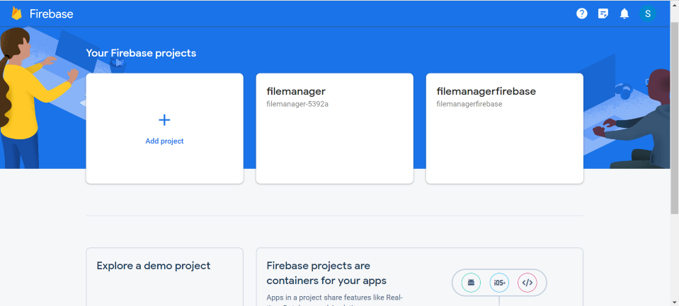
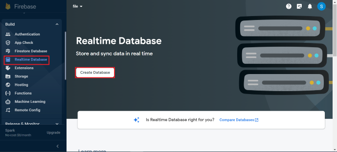
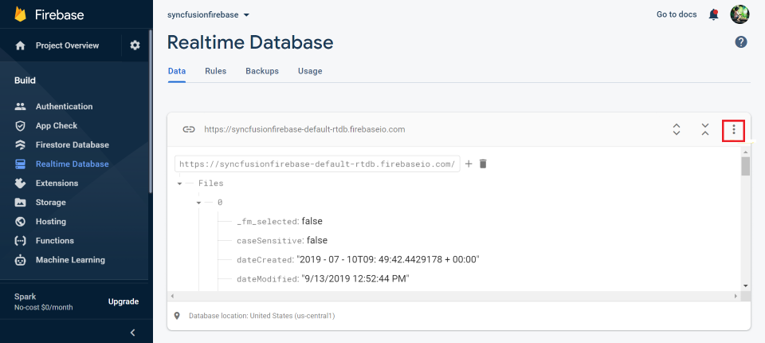
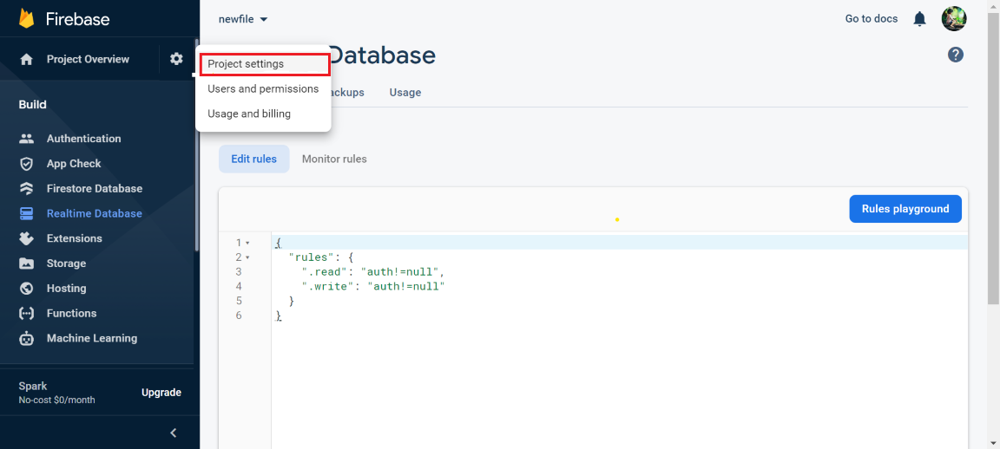
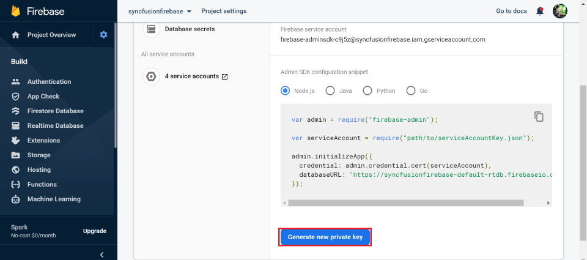
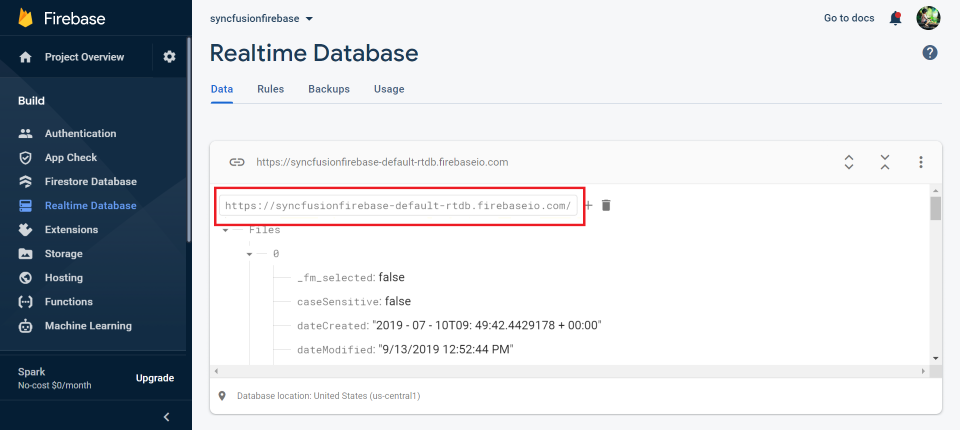
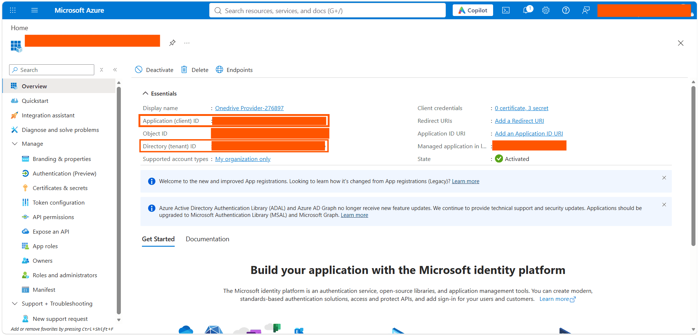

# File System Provider in ASP.NET Core File Manager

The file system provider allows the File Manager control to manage the files and folders in a physical or cloud-based file system. It provides the methods for performing various file actions like creating a new folder, copying and moving of files or folders, deleting, uploading, and downloading the files or folders in the file system.

The following file providers are added in EJ2 File Manager control.

* [Physical file system provider](#physical-file-system-provider)
* [Azure cloud file system Provider](#azure-cloud-file-system-provider)
* [Amazon S3 cloud file system provider](#amazon-s3-cloud-file-system-provider)
* [SharePoint file provider](#SharePoint-file-provider)
* [File Transfer Protocol file system provider](#file-transfer-protocol-file-system-provider)
* [SQL database file system provider](#sql-database-file-system-provider)
* [NodeJS file system provider](#nodejs-file-system-provider)
* [Google Drive file system provider](#google-drive-file-system-provider)
* [Firebase Realtime Database file system provider](#firebase-realtime-database-file-system-provider)
* [IBM Cloud Object Storage provider](#ibm-cloud-object-storage-file-provider)
* [OneDrive file system provider](#onedrive-file-system-provider)

## Physical file system provider

The Physical file system provider allows the users to access and manage the physical file system. To get started, clone the [ej2-aspcore-file-provider](https://github.com/SyncfusionExamples/ej2-aspcore-file-provider) using the following command.

```typescript

git clone https://github.com/SyncfusionExamples/ej2-aspcore-file-provider  ej2-aspcore-file-provider

cd ej2-aspcore-file-provider

```

After cloning, just open the project in Visual Studio and restore the NuGet packages. Now, set the root directory of the physical file system in the File Manager controller.

After setting the root directory of the file system, just build and run the project. Now, the project will be hosted in `http://localhost:{port}` and just mapping the **ajaxSettings** property of the File Manager control to the appropriate controller methods allows to manage the files in the physical file system.









N> To learn more about file actions that can be performed with Physical file system provider, refer to this [link](https://github.com/SyncfusionExamples/ej2-aspcore-file-provider#key-features)

## Azure cloud file system Provider

The Azure file system provider allows the users to access and manage the blobs in the Azure blob storage. To get started, clone the [azure-aspcore-file-provider](https://github.com/SyncfusionExamples/azure-aspcore-file-provider) using the following command.

```typescript

git clone https://github.com/SyncfusionExamples/azure-aspcore-file-provider.git azure-aspcore-file-provider

```

After cloning, just open the project in Visual Studio and restore the NuGet packages. Now, register the Azure storage by passing details like name, password, and blob name to the Register Azure method in the File Manager controller.

```typescript

void RegisterAzure(string accountName, string accountKey, string blobName)

 ```

Then, set the blob container and the root blob directory by passing the corresponding URLs as parameters in the setBlobContainer method as follows.

```typescript

void setBlobContainer(string blobPath, string filePath)

```

N> Also, assign the same *blobPath URL* and *filePath URL* in [**AzureFileOperations** and **AzureUpload**](https://github.com/SyncfusionExamples/azure-aspcore-file-provider/blob/master/Controllers/AzureProviderController.cs) methods in the File Manager controller to determine the original path of the Azure blob.

After setting the blob container references, build and run the project. The project will be hosted at `http://localhost:{port}`. Mapping the **ajaxSettings** property of the File Manager control to the appropriate controller methods allows to manage the Azure blob storage.









N> To learn more about file actions that can be performed with Azure cloud file system provider, refer to this [link](https://github.com/SyncfusionExamples/azure-aspcore-file-provider#key-features)

## Amazon S3 cloud file system provider

### Introduction to Amazon S3

Amazon Simple Storage Service (Amazon S3) is AWS's object storage service for storing and retrieving any amount of data. S3 is durable, scalable, and pay-as-you-go. In this guide the file manager connects to S3 through an ASP.NET Core backend so you can securely browse and perform file operations in the ASP.NET Core File Manager control.

### Prerequisites

Before you integrate Amazon S3 with the ASP.NET Core File Manager, ensure you have:
 - An AWS Account
 - A configured S3 Bucket
 - AWS credentials: `awsAccessKeyId`, `awsSecretAccessKeyId`, `bucketRegion`, `awsRegion`, `rootPath`.

### Setting Up Amazon S3

 - Open the [AWS Management Console guide](https://docs.aws.amazon.com/awsconsolehelpdocs/) and log into AWS Console -> Navigate to S3.
 - Proceed by clicking `Create Bucket`. A bucket is a container for objects. An object is a file and any metadata that describes that file. The Amazon S3 provider requires a top-level root folder in your bucket to place all required files and subfolders inside this root. Click this [link](https://docs.aws.amazon.com/AmazonS3/latest/userguide/creating-buckets-s3.html) for more details.
 - Provide a DNS-compliant bucket name. Click this [link](https://docs.aws.amazon.com/AmazonS3/latest/userguide/bucketnamingrules.html) for more details.
 - Choose the AWS region. Click this [link](https://docs.aws.amazon.com/general/latest/gr/s3.html) for more details.

### Backend Setup

Clone the [Amazon S3 File Provider](https://github.com/SyncfusionExamples/amazon-s3-aspcore-file-provider) using the following command,

```bash
git clone https://github.com/SyncfusionExamples/amazon-s3-aspcore-file-provider.git ej2-amazon-s3-aspcore-file-provider
```

N> This Amazon S3 provider for the ASP.NET Core File Manager is intended for demonstration and evaluation only. Before using it consult your security team and complete a security review.

To initialize a local service with the above-mentioned file operations, create a folder named `Controllers` in the server project. Then, create a `.cs` file in the `Controllers` folder and add the required file operation code from [AmazonS3ProviderController.cs](https://github.com/SyncfusionExamples/amazon-s3-aspcore-file-provider/blob/master/Controllers/AmazonS3ProviderController.cs). You can also find the method-level details for this provider in the same repository.

### Registering S3 Credentials in the Provider

After cloning, open the project in Visual Studio and restore the NuGet packages. Then, register the Amazon S3 client details (for example, **bucketName**, **awsAccessKeyId**, **awsSecretAccessKeyId**, **awsRegion** and **rootPath**) in the `RegisterAmazonS3` method in the `AmazonS3ProviderController.cs` file.

```csharp
this.operation.RegisterAmazonS3("<---bucketName--->", "<---awsAccessKeyId--->", "<---awsSecretAccessKey--->", "<---region--->", "<---rootPath--->");
```

The `rootPath` parameter specifies the folder path within the Amazon S3 bucket that is used as the File Manager root directory. A valid bucket-relative path must be provided during registration. All File Manager operations are restricted to the configured path and its contents.

N> Specify the path relative to the bucket root. The configured folder must already exist in the bucket and contain at least one object or subfolder.

### Configuring File Manager UI

After registering the Amazon client account details, build and run the project. The application will be hosted at `http://localhost:{port}`. Map the **ajaxSettings** property of the File Manager control to the appropriate controller methods to manage objects stored in the Amazon ***S3*** (*Simple Storage Service*) bucket.









To perform file operations (Read, Create, Rename, Delete, Get file details, Search, Copy, Move, Upload, Download, GetImage) in the ASP.NET Core File Manager control using the Amazon S3 cloud file provider, initialize the Amazon S3 cloud file provider in the controller.

### Supported File Operations

We have enabled below list of features that can be performed using Amazon File Service provider,

|Operation | Function |
|---|---|
| Upload | [Directory upload](https://help.syncfusion.com/cr/aspnetcore-js2/Syncfusion.EJ2.FileManager.FileManagerUploadSettings.html#Syncfusion_EJ2_FileManager_FileManagerUploadSettings_DirectoryUpload)<br/>[Sequential upload](https://help.syncfusion.com/cr/aspnetcore-js2/Syncfusion.EJ2.FileManager.FileManagerUploadSettings.html#Syncfusion_EJ2_FileManager_FileManagerUploadSettings_SequentialUpload)<br/>[Chunk Size](https://help.syncfusion.com/cr/aspnetcore-js2/Syncfusion.EJ2.FileManager.FileManagerUploadSettings.html#Syncfusion_EJ2_FileManager_FileManagerUploadSettings_ChunkSize)<br/>[Auto upload](https://help.syncfusion.com/cr/aspnetcore-js2/Syncfusion.EJ2.FileManager.FileManagerUploadSettings.html#Syncfusion_EJ2_FileManager_FileManagerUploadSettings_AutoUpload) |
| Access Control | [Setting rules to files/folders](https://github.com/SyncfusionExamples/amazon-s3-aspcore-file-provider/blob/master/Models/AmazonS3FileProvider.cs#L67)<br/>[Supported rules](https://github.com/SyncfusionExamples/amazon-s3-aspcore-file-provider/blob/master/Models/Base/AccessDetails.cs#L65) |

Additionally, you can check out all the necessary file operation method details for this provider in the same GitHub repository. To access the live Amazon S3 File Provider demo refer to this [link](https://ej2.syncfusion.com/aspnetcore/filemanager/amazons3provider#/fluent2)

N> To learn more about the file actions that can be performed with Amazon S3 cloud file provider, refer to this [link](https://github.com/SyncfusionExamples/amazon-s3-aspcore-file-provider#key-features).

## SharePoint file provider

The SharePoint file provider allows users to access and manage files within Microsoft SharePoint. To get started, clone the [SharePoint-aspcore-file-provider](https://github.com/SyncfusionExamples/sharepoint-aspcore-file-provider) using the following command.

```typescript

git clone https://github.com/SyncfusionExamples/sharepoint-aspcore-file-provider  sharepoint-aspcore-file-provider

cd sharepoint-aspcore-file-provider

```

**Prerequisites**

To set up the SharePoint service provider, follow these steps:

1. **Create an App Registration in Azure Active Directory (AAD):** 
   - Navigate to the Azure portal and create a new app registration under Azure Active Directory.
   - Note down the **Tenant ID**, **Client ID**, and **Client Secret** from the app registration.

2. **Use Microsoft Graph Instance:** 
   - With the obtained Tenant ID, Client ID, and Client Secret, you can create a Microsoft Graph instance.
   - This instance will be used to interact with the SharePoint document library.

3. **Use Details from `appsettings.json`:**
   - The `SharePointController` is already configured to use the credentials provided in the `appsettings.json` file.
   - You only need to provide your `Tenant ID`, `Client ID`, `Client Secret`, `User Site Name`, and `User Drive ID` in the `appsettings.json` file, and the application will automatically initialize the SharePoint service.

**Example `appsettings.json` Configuration**

```typescript
{
  "Logging": {
    "LogLevel": {
      "Default": "Warning"
    }
  },
  "SharePointSettings": {
    "TenantId": "<--Tenant Id-->",
    "ClientId": "<--Client Id-->",
    "ClientSecret": "<--Client Secret-->",
    "UserSiteName": "<--User Site Name-->",
    "UserDriveId": "<--User Drive ID-->"
  },
  "AllowedHosts": "*"
}

```

Replace "<--User Site Name-->", "<--User Drive ID-->", "tenantId", "clientId", and "clientSecret" with your actual values.

After configuring the SharePoint file provider, build and run the project. Now, the project will be hosted in `http://localhost:{port}` and just mapping the **ajaxSettings** property of the File Manager control to the appropriate controller methods allows to manage the files in the Microsoft SharePoint.









N> **Note:** To learn more about the file actions that can be performed with SharePoint file provider, refer to this [link](https://github.com/SyncfusionExamples/sharepoint-aspcore-file-provider#key-features)

## File Transfer Protocol file system provider

In ASP.NET Core, File Transfer Protocol file system provider allows the users to access to the hosted file system as collection of objects stored in the file storage using File Transfer Protocol. To get started, clone the [ftp-aspcore-file-provider](https://github.com/SyncfusionExamples/ftp-aspcore-file-provider) using the following command.

```typescript

git clone https://github.com/SyncfusionExamples/ftp-aspcore-file-provider.git ftp-aspcore-file-provider.git

```

After cloning, open the project in Visual Studio and restore the NuGet packages. Now, register File Transfer Protocol details like *hostName*, *userName* and *password* in **SetFTPConnection** method in the File Manager controller to perform the file operations.

```typescript

 void SetFTPConnection(string hostName, string userName, string password)

```

After registering the File Transfer Protocol details, just build and run the project. Now, the project will be hosted in `http://localhost:{port}` and just mapping the **ajaxSettings** property of the File Manager control to the appropriate controller methods allows you to manage the FTP’s objects storage.









N> To learn more about the file actions that can be performed with File Transfer Protocol file system provider, refer to this [link](https://github.com/SyncfusionExamples/ftp-aspcore-file-provider#key-features).

## SQL database file system provider

In ASP.NET Core, SQL database file system provider allows the users to manage the file system being maintained in a SQL database table. Unlike the other file system providers, the SQL database file system provider works on an ID basis. Here, each file and folder have a unique ID based on which all the file operations will be performed. To get started, clone the [sql-server-database-aspcore-file-provider](https://github.com/SyncfusionExamples/sql-server-database-aspcore-file-provider) using the following command.

```typescript

<add name="FileExplorerConnection" connectionString="Data Source=(LocalDB)\v11.0;AttachDbFilename=|DataDirectory|\FileManager.mdf;Integrated Security=True;Trusted_Connection=true" />

```

After cloning, just open the project in Visual Studio and restore the NuGet packages. To establish the SQL server connection with the database file (for eg: FileManager.mdf), specify the connection string in the web config file as follows.

```typescript

<add name="FileExplorerConnection" connectionString="Data Source=(LocalDB)\v11.0;AttachDbFilename=|DataDirectory|\FileManager.mdf;Integrated Security=True;Trusted_Connection=true" />

```

Then, make an entry for the connection string in `appsettings.json` file as follows.

```typescript

"ConnectionStrings": {
    "FileManagerConnection": "Data Source=(LocalDB)\\MSSQLLocalDB;AttachDbFilename=|DataDirectory|\\App_Data\\FileManager.mdf;Integrated Security=True;Connect Timeout=30"
}

```

Now, to configure the database connection, set the connection name, table name and root folder ID value by passing these values to the SetSQLConnection method.

```typescript

void SetSQLConnection(string name, string tableName, string tableID)

```

N> Refer to this [FileManager.mdf](https://github.com/SyncfusionExamples/sql-server-database-aspcore-file-provider/blob/master/App_Data/FileManager.mdf), to learn about the pre-defined file system SQL database for the EJ2 File Manager.

After configuring the connection, just build and run the project. Now, the project will be hosted in `http://localhost:{port}` and just mapping the **ajaxSettings** property of the File Manager control to the appropriate controller methods allows to manage the files in the SQL database table.









N> To learn more about file actions that can be performed with SQL database file system provider, refer to this [link](https://github.com/SyncfusionExamples/sql-server-database-aspcore-file-provider#key-features).

## Node.js file system provider

In ASP.NET Core, Node.js file system provider allows the users to manage the files and folders in a physical file system. It provides methods for performing all basic file operations like creating a folder, copy, move, delete, and download files and folders in the file system. We can use the Node.js file system provider either by installing the [ej2-filemanager-node-filesystem](https://www.npmjs.com/package/@syncfusion/ej2-filemanager-node-filesystem) package or by cloning the [file system provider](https://github.com/SyncfusionExamples/ej2-filemanager-node-filesystem) from GitHub.

### Using ej2-filemanager-node-filesystem package

* Install the ej2-filemanager-node-filesystem package by running the below command.

```typescript

npm install @syncfusion/ej2-filemanager-node-filesystem

```

* After installing the package, navigate to the ej2-filemanager-node-filesystem package folder within the node-modules.
* Run the command **npm install** command.

### Cloning the ej2-filemanager-node-filesystem from GitHub

* Clone the ej2-filemanager-node-filesystem using the following command.

```typescript

git clone  https://github.com/SyncfusionExamples/ej2-filemanager-node-filesystem.git node-filesystem-provider

```

* After cloning, open the root folder and run the command **npm install** command.

After installing the packages, set the root folder directory of the physical file system in the package JSON under scripts sections as follows.

```typescript

"start": "node filesystem-server.js -d D:/Projects"

```

N> By default, the root directory will be configured to set `C:/Users` as the root directory.

To set the port in which the project to be hosted and the root directory of the file system. Run the following command.

```typescript

set PORT=3000 && node filesystem-server.js -d D:/Projects

```

N> By default, the service will run `8090` port.

Now, just mapping the **ajaxSettings** property of the File Manager control to the appropriate file operation methods in the filesystem-server.js file will allows to manage the physical file system with Node.js file system provider.









N> To learn more about file actions that can be performed with Node.js file system provider, refer to this [link](https://github.com/SyncfusionExamples/ej2-filemanager-node-filesystem#key-features).

## Google Drive file system provider

In ASP.NET Core, Google Drive file system provider allows the users to manage the files and folders in a Google Drive account. The Google Drive file system provider works on ID basis where each file and folder have a unique ID. To get started,  clone the [google-drive-aspcore-file-provider](https://github.com/SyncfusionExamples/google-drive-aspcore-file-provider) using the following command.

```typescript

git clone https://github.com/SyncfusionExamples/google-drive-aspcore-file-provider  google-drive-aspcore-file-provider

cd google-drive-aspcore-file-provider

```

Google Drive file system provider use the [Google Drive APIs](https://developers.google.com/workspace/drive/api/reference/rest/v3) to read the file in the file system and uses the [OAuth 2.0](https://developers.google.com/identity/protocols/oauth2) protocol for authentication and authorization. To authenticate from the client end, obtain OAuth 2.0 client credentials from the `Google API Console`. To learn more about generating the client credentials from the Google API Console, refer to this [link](https://developers.google.com/identity/protocols/oauth2/javascript-implicit-flow).

After generating the client secret data, copy the JSON data to the following specified JSON files in the cloned location.

* EJ2GoogleDriveFileProvider > credentials > client_secret.json

* GoogleOAuth2.0Base > credentials > client_secret.json

After updating the credentials, just build and run the project. Now, the project will be hosted in `http://localhost:{port}`, and it will ask to log on to the Gmail account created the client secret credentials. Then, provide permission to access the Google Drive files by clicking the allow access button in the page. Now, just mapping the **ajaxSettings** property of the File Manager control to the appropriate controller methods will allows to manage the files from the Google Drive.









N> To learn more about file actions that can be performed with Google Drive file system provider, refer to this [link](https://github.com/SyncfusionExamples/google-drive-aspcore-file-provider#key-features).

## Firebase Realtime Database file system provider

The [Firebase Realtime Database](https://firebase.google.com/) file system provider in **ASP.NET Core** provides the efficient way to store the File Manager file system in a cloud database as JSON representation.

### Generate Secret access key from service account

Follow the given steps to generate the secret access key:

* To access the Firebase console, please click on this [link](https://console.firebase.google.com/). Once you have accessed the console, you can create a new project by filling in the necessary fields and clicking on the relevant buttons.



* Within the Firebase console, navigate to the **Build** tab. Under this tab, select the option for **Realtime Database**. From there, you can create a new database by clicking on the **Create Database** button.



* To get started, create a root node and add any desired children to it. Please refer to the following code snippet for guidance on the structure of the JSON:

```typescript

{
  "Files" : [ {
    "caseSensitive" : false,
    "dateCreated" : "8/22/2019 5:17:55 PM",
    "dateModified" : "8/22/2019 5:17:55 PM",
    "filterId" : "0/",
    "filterPath" : "/",
    "hasChild" : false,
    "id" : "5",
    "isFile" : false,
    "isRoot" : true,
    "name" : "Music",
    "parentId" : "0",
    "selected" : false,
    "showHiddenItems" : false,
    "size" : 0,
    "type" : "folder"
  },
   {
    "caseSensitive" : false,
    "dateCreated" : "8/22/2019 5:18:03 PM",
    "dateModified" : "8/22/2019 5:18:03 PM",
    "filterId" : "0/",
    "filterPath" : "/",
    "hasChild" : false,
    "id" : "6",
    "isFile" : false,
    "isRoot" : true,
    "name" : "videos",
    "parentId" : "0",
    "selected" : false,
    "showHiddenItems" : false,
    "size" : 0,
    "type" : ""
  }]
 }

```

Here, the `Files` denotes the `rootNode` and the subsequent object refers to the children of the root node. `rootNode` will be taken as the root folder of the file system loaded which will be loaded in File Manager control.

* To import a JSON file into the Firebase Realtime Database, navigate to the **Data** tab and click on the action icon shown in the accompanying image. From there, select the **Import JSON** option and upload the JSON file that was created using the code provided above.



* To interact with the Firebase Realtime Database through your application, it is necessary to grant read and write permissions by defining appropriate rules in the Firebase project's **Rules tab**, as shown in the following code snippet. Once you have specified the rules, you can publish them by clicking the **Publish** button to enable the necessary authentication.

```typescript

{
  /* Visit https://firebase.google.com/docs/database/security to learn more about security rules. */
  "rules": {
    ".read": "auth!=null",
    ".write": "auth!=null"
  }
}

```

> **Note:** By default, rules of a Firebase project will be **false**. To read and write the data, configure the  **Rules** as given in the following code snippet in the *Rules* tab in the Firebase Realtime Database project.

* Navigate to the project settings as instructed and then click on the **Service Account** tab.



* To obtain the access key JSON file, simply click on the `Generate new private key` button and then confirm by clicking the `Generate key` button in the pop-up window that appears.



* Next, you will need to clone the [`firebase-realtime-database-aspcore-file-provider`](https://github.com/SyncfusionExamples/firebase-realtime-database-aspcore-file-provider) repository. Once cloned, simply open the project in Visual Studio and restore the NuGet package.

* Once you have generated the secret key, you will need to replace the JSON in the `access_key.json` file in the Firebase Realtime Database provider project with the newly generated key. This will enable authentication and allow you to perform read and write operations.

* In the **Data** tab, locate the project API URL and then paste it into the below mentioned section.



Register the Firebase Realtime Database by assigning *Firebase Realtime Database REST API link*, *rootNode*, and *serviceAccountKeyPath* parameters in the `RegisterFirebaseRealtimeDB` method of class `FirebaseRealtimeDBFileProvider` in the controller part of the ASP.NET Core application.

```typescript

this.operation.RegisterFirebaseRealtimeDB(string apiUrl, string rootNode, string serviceAccountKeyPath)

```

**Example:**

```typescript

this.operation.RegisterFirebaseRealtimeDB("{copy your API URL here}", "Files", hostingEnvironment.ContentRootPath + \\FirebaseRealtimeDBHelper\\access_key.json);

```

In the above code,

* `{copy your API URL here}` denotes Firebase Realtime Database REST API link.

* `Files` denotes newly created root node in Firebase Realtime  Database.

* `hostingEnvironment.ContentRootPath + \\FirebaseRealtimeDBHelper\\access_key.json` denotes service account key path which has authentication key for the Firebase Realtime Database data.

After configuring the Firebase Realtime Database service link, build and run the project. Now, the project will be hosted in `http://localhost:{port}` and just mapping the **ajaxSettings** property of the File Manager control to the appropriate controller methods allows to manage the files in the Firebase Realtime Database.









N> To learn more about the file actions that can be performed with Firebase Realtime Database file system provider, refer to this [link](https://github.com/SyncfusionExamples/firebase-realtime-database-aspcore-file-provider#key-features).

## IBM Cloud Object Storage file provider

The IBM Cloud Object Storage file provider module allows you work with the IBM Cloud Object Storage. It also provides the methods for performing various file actions such as creating a new folder, renaming files, and deleting files. The IBM Cloud Object Storage file provider serves the file provider support for the File Manager control with the IBM Cloud Object Storage. We can make use of IBM Cloud Object Storage file provider by installing the [ej2-filemanager-ibm-cos-node-file-provider](https://www.npmjs.com/package/@syncfusion/ej2-filemanager-ibm-cos-node-file-provider) npm package or by cloning the [file provider](https://github.com/SyncfusionExamples/filemanager-ibm-cos-node-file-provider) from the GitHub.

### Using ej2-filemanager-ibm-cos-node-file-provider npm package

* Install the ej2-filemanager-ibm-cos-node-file-provider npm package by running the below command.

```typescript

npm install @syncfusion/ej2-filemanager-ibm-cos-node-file-provider

```

* After installing the package, navigate to the ej2-filemanager-ibm-cos-node-file-provider package folder within the node-modules.

* Run the  **npm install** command to install the dependent packages for file provider.

### Cloning the filemanager-ibm-cos-node-file-provider from GitHub

* Clone the filemanager-ibm-cos-node-file-provider using the following command.

```typescript

git clone https://github.com/SyncfusionExamples/filemanager-ibm-cos-node-file-provider.git

```

* After cloning, open the root folder and run the command **npm install** command.

To set the port in which the project to be hosted. Run the following command.

```typescript

set PORT=3000 && node index.js

```

N> By default, the service will run `8090` port.

Now, just mapping the **ajaxSettings** property of the File Manager control to the appropriate file operation methods in the index.js file will allow to manage the IBM Cloud Object Storage.









N> To learn more about the file actions that can be performed with IBM Cloud Object Storage file provider, refer to this [link](https://github.com/SyncfusionExamples/filemanager-ibm-cos-node-file-provider#key-features).

## OneDrive file system provider

### Introduction to OneDrive

Microsoft OneDrive is a cloud storage service from Microsoft that lets you store, share, and sync files across devices. In this guide, the File Manager connects to OneDrive through the Microsoft Graph API using an ASP.NET Core back end, so you can securely browse and perform file operations in the ASP.NET Core File Manager control. The OneDrive file system provider works on an ID basis where each file and folder has a unique ID.

### Prerequisites

Before you integrate OneDrive with the ASP.NET Core File Manager control, ensure you have:

 - A Microsoft Azure account with access to the [Azure portal](https://portal.azure.com/).
 - A OneDrive storage account in the same directory (tenant) as the Azure AD application.
 - Azure AD app registration details: `TenantId`, `ClientId`, and `ClientSecret`.
 - Microsoft Graph API permissions: `Files.Read.All` and `Files.ReadWrite.All`.
 - OneDrive details: `DriveId` and `RootFolderId`.

N> The Azure AD application and the OneDrive storage account must belong to the **same directory (tenant)**. The provider authenticates as the application principal and accesses the drive under that tenant.

### Setting Up OneDrive

**Create an app registration in Azure Active Directory**

 - Navigate to the [Azure portal](https://portal.azure.com/#view/Microsoft_AAD_IAM/ActiveDirectoryMenuBlade/~/RegisteredApps) and create a new app registration by selecting the **New registration** button under **Azure Active Directory**.
 - Note down the **Tenant ID** and **Client ID** from the app registration overview page.
 - Create a **Client Secret** under the **Certificates & secrets** section of the app registration and note down the secret value.

   

**Grant Microsoft Graph API permissions**

 - In the app registration, under **Manage**, select **API permissions** and click **Add a permission**.
 - In the **Request API permissions** dialog, choose **Microsoft Graph**.
 - Select **Application permissions**, and then add the following permissions:
     * **Files.Read.All**
     * **Files.ReadWrite.All**
 - Click **Add permissions** and then select **Grant admin consent** to approve the added permissions for the tenant.

   

### Back end Setup

Clone the [OneDrive File Provider](https://github.com/SyncfusionExamples/onedrive-aspcore-file-provider) using the following command,

```bash

git clone https://github.com/SyncfusionExamples/onedrive-aspcore-file-provider onedrive-aspcore-file-provider

cd onedrive-aspcore-file-provider

```

N> This OneDrive provider for the ASP.NET Core File Manager control is intended for demonstration and evaluation only. Before using it, consult your security team and complete a security review.

### Registering OneDrive Credentials in the Provider

After cloning, open the project in Visual Studio and restore the NuGet packages. Then, register the OneDrive account details (**TenantId**, **ClientId**, **ClientSecret**, **DriveId** and **RootFolderId**) in the `appsettings.json` file used by the `OneDriveProviderController`. The controller is already configured to read the credentials provided in the `appsettings.json` file, and the application will automatically initialize the OneDrive service.

```json

{
  "OneDriveSettings": {
    "TenantId": "<--Tenant Id-->",
    "ClientId": "<--Client Id-->",
    "ClientSecret": "<--Client Secret-->",
    "DriveId": "<--Drive Id-->",
    "RootFolderId": "<--Root Folder Id-->"
  }
}

```

Replace "<--Tenant Id-->", "<--Client Id-->", "<--Client Secret-->", "<--Drive Id-->", and "<--Root Folder Id-->" with your actual values. When the `RootFolderId` is set, the File Manager treats the specified OneDrive folder as the root level, and only the files and folders within that folder will be displayed. When it is not set, all the files and folders in the OneDrive drive will be displayed.

**How to get the Drive ID and Folder ID using Graph Explorer**

The `DriveId` and `RootFolderId` values can be retrieved using the [Microsoft Graph Explorer](https://developer.microsoft.com/en-us/graph/graph-explorer).

 - **Get the Drive ID:** Run the following query in the Graph Explorer to get the drive details of the signed-in user. The `id` property in the response is the **Drive ID**.

   ```ts

   GET https://graph.microsoft.com/v1.0/me/drive

   ```

 - **Get the Folder ID:** Run the following query in the Graph Explorer to list the folders in the drive root. The `id` property of the required folder in the response is the **Folder ID** to be used as the `RootFolderId` value.

   ```ts

   GET https://graph.microsoft.com/v1.0/me/drive/root/children

   ```

 - **Get the Folder ID of any nested folder:** To get the item ID of a folder located under a specific parent folder, run the following query by replacing `{parent-item-id}` with the parent folder's item ID.

   ```ts

   GET https://graph.microsoft.com/v1.0/me/drive/items/{parent-item-id}/children

   ```

### Configuring File Manager UI

After registering the OneDrive account details, build and run the project. The application will be hosted at `http://localhost:{port}`. Map the **ajaxSettings** property of the File Manager control to the appropriate controller methods to manage the files and folders in the Microsoft OneDrive.

```cshtml

<div class=" control-section">
    <div class="sample-container">
        <!--  Initialize File Manager control with OneDrive file system -->
        <!--Replace the hosted port number in the place of "{port}"-->
        <ejs-filemanager id="filemanager">
            <e-filemanager-ajaxsettings
                    url="http://localhost:{port}/api/OneDriveProvider/OneDriveFileOperations",
                    getImageUrl="http://localhost:{port}/api/OneDriveProvider/OneDriveGetImage",
                    downloadUrl="http://localhost:{port}/api/OneDriveProvider/OneDriveDownload",
                    uploadUrl="http://localhost:{port}/api/OneDriveProvider/OneDriveUpload">
            </e-filemanager-ajaxsettings>
        </ejs-filemanager>
    </div>
</div>

```

N> To learn more about file actions that can be performed with OneDrive file system provider, refer to this [link](https://github.com/SyncfusionExamples/onedrive-aspcore-file-provider#key-features).
