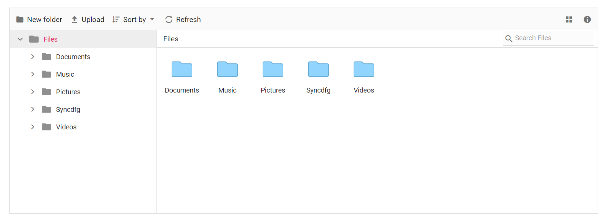

# How to customize thumbnails in ASP.NET Core File Manager

The default appearance of the File Manager can be customized with your own icon by using the `showThumbnail` property.

The following example demonstrates how to add a custom icon in the large icons view.










The output will look like the image below.

