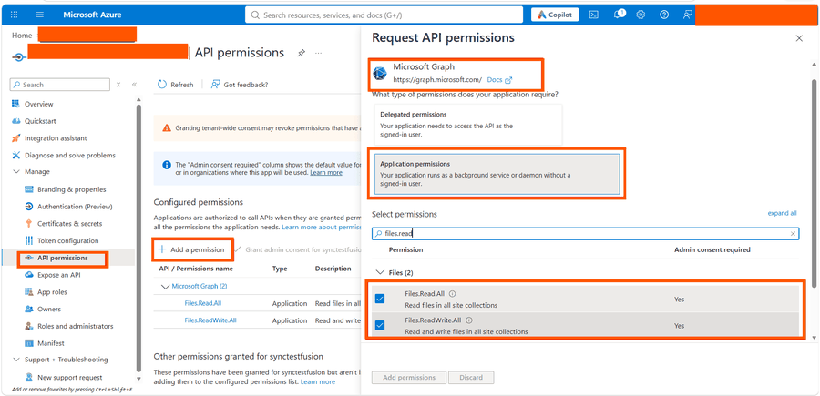

# OneDrive Provider in Blazor File Manager

## Introduction to OneDrive

Microsoft OneDrive is a cloud storage service from Microsoft that lets you store, share, and sync files across devices. In this guide, the File Manager connects to OneDrive through the Microsoft Graph API using an ASP.NET Core back end, so you can securely browse and perform file operations in the Blazor File Manager component. The OneDrive file system provider works on an ID basis where each file and folder has a unique ID.

## Prerequisites

Before you integrate OneDrive with the Blazor File Manager component, ensure you have:

 - A Microsoft Azure account with access to the [Azure portal](https://portal.azure.com/).
 - A OneDrive storage account in the same directory (tenant) as the Azure AD application.
 - Azure AD app registration details: `TenantId`, `ClientId`, and `ClientSecret`.
 - Microsoft Graph API permissions: `Files.Read.All` and `Files.ReadWrite.All`.
 - OneDrive details: `DriveId` and `RootFolderId`.

N> The Azure AD application and the OneDrive storage account must belong to the **same directory (tenant)**. The provider authenticates as the application principal and accesses the drive under that tenant.

## Setting Up OneDrive

**Create an app registration in Azure Active Directory**

 - Navigate to the [Azure portal](https://portal.azure.com/#view/Microsoft_AAD_IAM/ActiveDirectoryMenuBlade/~/RegisteredApps) and create a new app registration by selecting the **New registration** button under **Azure Active Directory**.
 - Note down the **Tenant ID** and **Client ID** from the app registration overview page.
 - Create a **Client Secret** under the **Certificates & secrets** section of the app registration and note down the secret value.

   

**Grant Microsoft Graph API permissions**

 - In the app registration, under **Manage**, select **API permissions** and click **Add a permission**.
 - In the **Request API permissions** dialog, choose **Microsoft Graph**.
 - Select **Application permissions**, and then add the following permissions:
     * **Files.Read.All**
     * **Files.ReadWrite.All**
 - Click **Add permissions** and then select **Grant admin consent** to approve the added permissions for the tenant.

   

## Back end Setup

Clone the [OneDrive File Provider](https://github.com/SyncfusionExamples/onedrive-aspcore-file-provider) using the following command,

```bash

git clone https://github.com/SyncfusionExamples/onedrive-aspcore-file-provider onedrive-aspcore-file-provider

cd onedrive-aspcore-file-provider

```

N> This OneDrive provider for the Blazor File Manager component is intended for demonstration and evaluation only. Before using it, consult your security team and complete a security review.

## Registering OneDrive Credentials in the Provider

After cloning, open the project in Visual Studio and restore the NuGet packages. Then, register the OneDrive account details (**TenantId**, **ClientId**, **ClientSecret**, **DriveId** and **RootFolderId**) in the `appsettings.json` file used by the `OneDriveProviderController`. The controller is already configured to read the credentials provided in the `appsettings.json` file, and the application will automatically initialize the OneDrive service.

```json

{
  "OneDriveSettings": {
    "TenantId": "<--Tenant Id-->",
    "ClientId": "<--Client Id-->",
    "ClientSecret": "<--Client Secret-->",
    "DriveId": "<--Drive Id-->",
    "RootFolderId": "<--Root Folder Id-->"
  }
}

```

Replace "<--Tenant Id-->", "<--Client Id-->", "<--Client Secret-->", "<--Drive Id-->", and "<--Root Folder Id-->" with your actual values. When the `RootFolderId` is set, the File Manager treats the specified OneDrive folder as the root level, and only the files and folders within that folder will be displayed. When it is not set, all the files and folders in the OneDrive drive will be displayed.

**How to get the Drive ID and Folder ID using Graph Explorer**

The `DriveId` and `RootFolderId` values can be retrieved using the [Microsoft Graph Explorer](https://developer.microsoft.com/en-us/graph/graph-explorer).

 - **Get the Drive ID:** Run the following query in the Graph Explorer to get the drive details of the signed-in user. The `id` property in the response is the **Drive ID**.

   ```ts

   GET https://graph.microsoft.com/v1.0/me/drive

   ```

 - **Get the Folder ID:** Run the following query in the Graph Explorer to list the folders in the drive root. The `id` property of the required folder in the response is the **Folder ID** to be used as the `RootFolderId` value.

   ```ts

   GET https://graph.microsoft.com/v1.0/me/drive/root/children

   ```

 - **Get the Folder ID of any nested folder:** To get the item ID of a folder located under a specific parent folder, run the following query by replacing `{parent-item-id}` with the parent folder's item ID.

   ```ts

   GET https://graph.microsoft.com/v1.0/me/drive/items/{parent-item-id}/children

   ```

## Configuring File Manager UI

After registering the OneDrive account details, build and run the project. The application will be hosted at `http://localhost:{port}`. Map the **ajaxSettings** property of the Blazor File Manager component to the appropriate controller methods to manage the files and folders in the Microsoft OneDrive.

```cshtml

@*Initializing Blazor File Manager with OneDrive file system service.*@

@* Replace the hosted port number in the place of "{port}" *@
<SfFileManager TValue="FileManagerDirectoryContent">
    <FileManagerAjaxSettings Url="http://localhost:{port}/api/OneDriveProvider/OneDriveFileOperations"
                             UploadUrl="http://localhost:{port}/api/OneDriveProvider/OneDriveUpload"
                             DownloadUrl="http://localhost:{port}/api/OneDriveProvider/OneDriveDownload"
                             GetImageUrl="http://localhost:{port}/api/OneDriveProvider/OneDriveGetImage">
    </FileManagerAjaxSettings>
</SfFileManager>

```

N> To learn more about file actions that can be performed with OneDrive file system provider, refer to this [link](https://github.com/SyncfusionExamples/onedrive-aspcore-file-provider#key-features).
