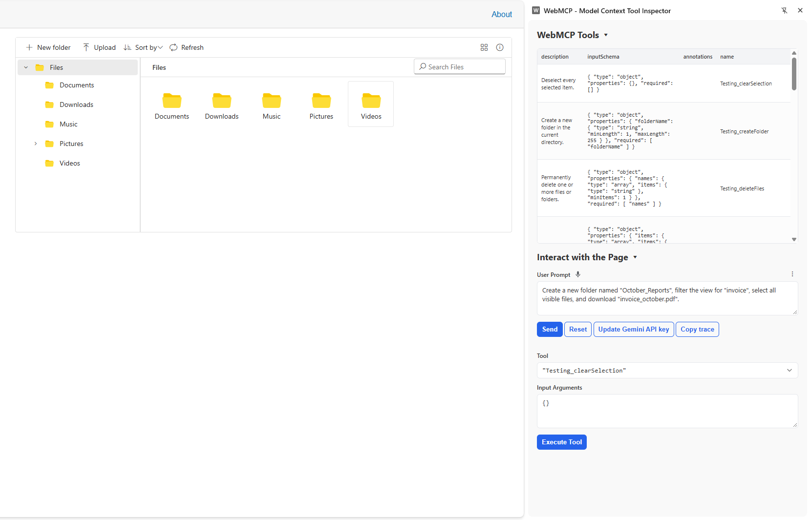
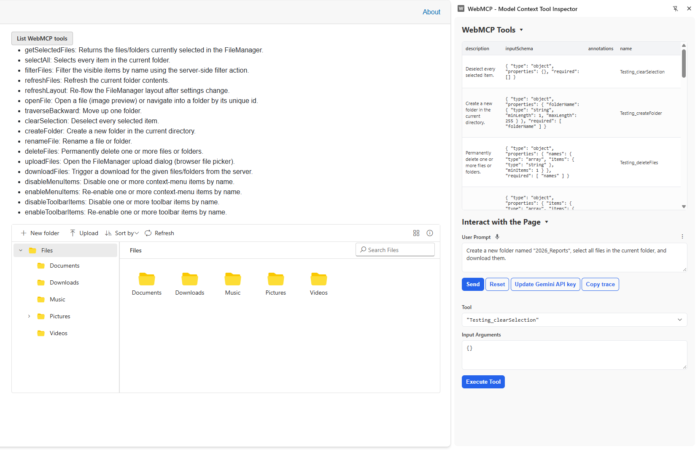
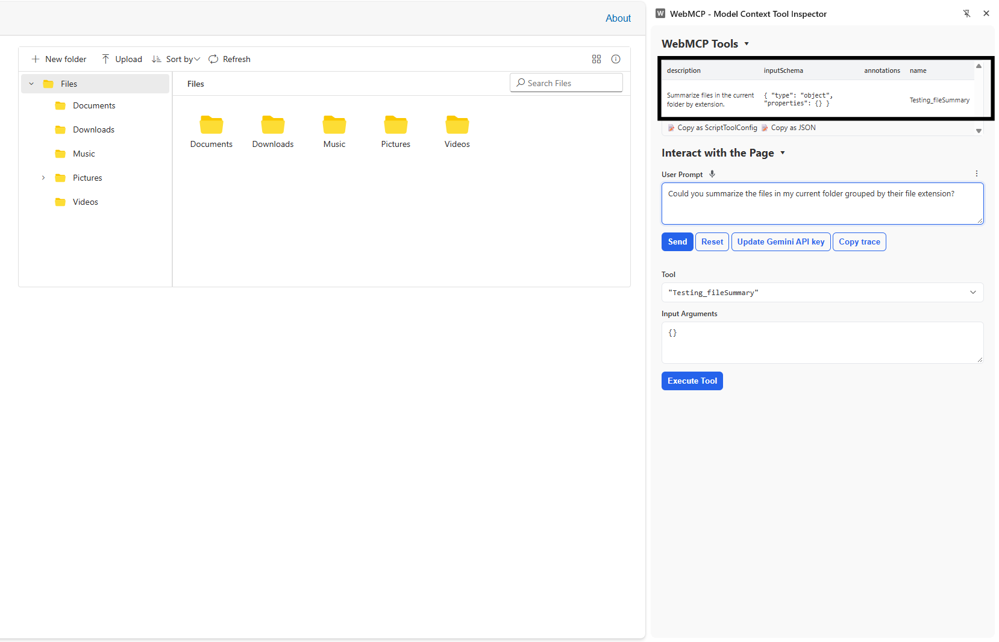
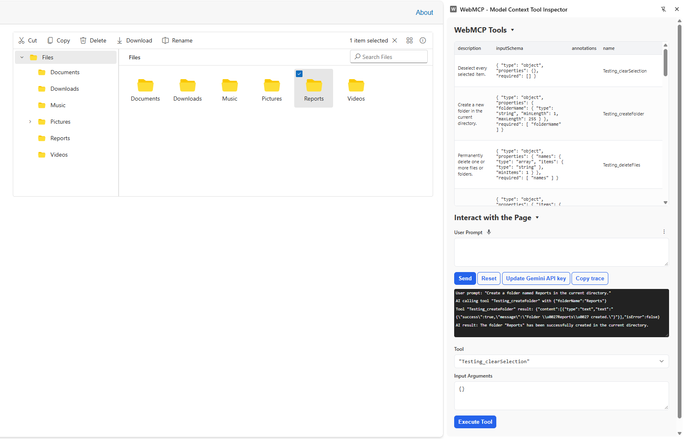

# Getting Started with WebMCP

Enable WebMCP on the Blazor File Manager with one property, then confirm its tools are registered in the browser. This example uses the File Manager component.

## Prerequisites

Before you begin, ensure you have:

* A Blazor app with the Syncfusion&reg; File Manager component already rendering. Use an interactive render mode. Static SSR does not run the browser registration. See [interactive render mode](https://blazor.syncfusion.com/documentation/common/interactive-render-mode).
* A Chromium-based browser with the WebMCP origin trial or `chrome://flags/#enable-webmcp` enabled. The API is experimental, so confirm it in the browser versions you support.

## Enable WebMCP

Set `EnableWebMcp` to `true`. Optionally set `Name` on the component's `FileManagerWebMcpSettings` tag so tool names stay unique on the page.




@page "/"
@using Syncfusion.Blazor.FileManager;

<SfFileManager TValue="FileManagerDirectoryContent"
               EnableWebMcp="true"
               @ref="FileManager"
               ID="FM">
    <FileManagerAjaxSettings Url="https://physical-service.syncfusion.com/api/FileManager/FileOperations"
                             UploadUrl="https://physical-service.syncfusion.com/api/FileManager/Upload"
                             DownloadUrl="https://physical-service.syncfusion.com/api/FileManager/Download"
                             GetImageUrl="https://physical-service.syncfusion.com/api/FileManager/GetImage">
    </FileManagerAjaxSettings>
    <FileManagerWebMcpSettings Name="Testing">
    </FileManagerWebMcpSettings>
</SfFileManager>

@code {
    private SfFileManager<FileManagerDirectoryContent>? FileManager;
}




`EnableWebMcp` turns registration on. `Name` becomes the prefix for the tool names. If you omit it, the component `ID` is used, then a generated ID.

## Verify the tools

Call `GetWebMcpToolsAsync` to list the tools the component registered.




@page "/"
@using Syncfusion.Blazor.FileManager;

<button class="e-btn" @onclick="ShowToolsAsync">List WebMCP tools</button>

<ul>
    @foreach (var line in ToolLines)
    {
        <li>@line</li>
    }
</ul>

<SfFileManager TValue="FileManagerDirectoryContent"
               EnableWebMcp="true"
               @ref="FileManager"
               ID="FM">
    <FileManagerAjaxSettings Url="https://physical-service.syncfusion.com/api/FileManager/FileOperations"
                             UploadUrl="https://physical-service.syncfusion.com/api/FileManager/Upload"
                             DownloadUrl="https://physical-service.syncfusion.com/api/FileManager/Download"
                             GetImageUrl="https://physical-service.syncfusion.com/api/FileManager/GetImage">
    </FileManagerAjaxSettings>
    <FileManagerWebMcpSettings Name="Testing">
    </FileManagerWebMcpSettings>
</SfFileManager>

@code {
    private SfFileManager<FileManagerDirectoryContent>? FileManager;
    private List<string> ToolLines = new();

    private async Task ShowToolsAsync()
    {
        if (FileManager is null) return;
        var tools = await FileManager.GetWebMcpToolsAsync();
        ToolLines = tools.Select(t => $"{t.Name}: {t.Description}").ToList();
    }
}




Pass a list of names to `GetWebMcpToolsAsync` to inspect specific tools only.

## Supported tools

The Blazor File Manager ships built-in WebMCP tools for reading and for write operations.

### Read Tools

| Tool Name | Description |
| --------- | ----------- |
| getSelectedFiles | Returns the list of currently selected files and folders, including metadata such as name, ID, type, size, and modification details |
| selectAll | Selects all files and folders in the current view |
| filterFiles | Applies filters to files and folders based on specified criteria |
| refreshFiles | Refreshes the current file view |
| refreshLayout | Refreshes the File Manager layout |
| openFile | Opens the selected file or folder |
| traverseBackward | Navigates backward to the parent folder |
| clearSelection | Clears the current selection |

### Write Tools

| Tool Name | Description |
| --------- | ----------- |
| createFolder | Creates a new folder in the current directory |
| renameFile | Renames a file or folder |
| deleteFiles | Deletes one or more selected files or folders |
| uploadFiles | Opens the upload dialog to upload files |
| downloadFiles | Downloads one or more selected files |
| disableMenuItems | Disables one or more context menu items |
| enableMenuItems | Enables one or more context menu items |
| disableToolbarItems | Disables one or more toolbar items |
| enableToolbarItems | Enables one or more toolbar items |

## Configure tools

Each File Manager ships the built-in tools listed above. You can enable, disable, or rename them, add custom tools, and handle every call in `OnWebMcpExecute`. Tools are declared inside `FileManagerWebMcpSettings` > `FileManagerWebMcpTools` > `FileManagerWebMcpTool` child tags.

A built-in tool is selected with `Command`. The properties below apply to every tool entry.

| Property | Purpose | Default |
| --- | --- | --- |
| `Command` | Built-in command to configure, or `Custom` for your own tool | `None` |
| `Name` | Registered tool name. Required for custom tools. Optional override for built-in tools. Use PascalCase, for example `CreateFolder` | Generated |
| `Description` | Text the agent reads to decide when to call the tool | Built-in text |
| `InputSchema` | Object schema for the tool's arguments. Required for custom tools. Pass an object whose `type` is `object`, not a JSON string | Built-in schema |
| `Enabled` | Whether the tool is registered with the browser | `true` |

The registered name is `{Prefix}_{Tool}`. The prefix is the `Name` on `FileManagerWebMcpSettings`, or the component `ID` when `Name` is empty. Use PascalCase for that name. The tool part is the built-in command, or the `Name` you set on a custom tool. With `Name="Testing"`, `CreateFolder` is registered as `Testing_CreateFolder`, and a custom tool named `FileSummary` is registered as `Testing_FileSummary`. Match that full string, or use `EndsWith("_CreateFolder")`, so a partial suffix does not match another tool. Call `GetWebMcpToolsAsync` and read `Name` if you need the exact value for an instance.




@page "/"
@using Syncfusion.Blazor.FileManager;

<SfFileManager TValue="FileManagerDirectoryContent"
               EnableWebMcp="true"
               @ref="FileManager"
               ID="FM">
    <FileManagerEvents TValue="FileManagerDirectoryContent" OnWebMcpExecute="BeforeMcpHandler"></FileManagerEvents>
    <FileManagerAjaxSettings Url="https://physical-service.syncfusion.com/api/FileManager/FileOperations"
                             UploadUrl="https://physical-service.syncfusion.com/api/FileManager/Upload"
                             DownloadUrl="https://physical-service.syncfusion.com/api/FileManager/Download"
                             GetImageUrl="https://physical-service.syncfusion.com/api/FileManager/GetImage">
    </FileManagerAjaxSettings>
    <FileManagerWebMcpSettings Name="Testing">
        <FileManagerWebMcpTools>
            <FileManagerWebMcpTool Command="FileManagerWebMcpToolCommand.CreateFolder"
                                   Enabled="false" />
            <FileManagerWebMcpTool Command="@FileManagerWebMcpToolCommand.Custom"
                                   Name="fileSummary"
                                   Description="Summarize files in the current folder by extension."
                                   InputSchema="@EmptySchema"
                                   Enabled="true" />
        </FileManagerWebMcpTools>
    </FileManagerWebMcpSettings>
</SfFileManager>

@code {
    private SfFileManager<FileManagerDirectoryContent>? FileManager;

    private object EmptySchema { get; set; } = new
    {
        type = "object",
        properties = new { }
    };

    private async Task BeforeMcpHandler(FileManagerWebMcpExecuteEventArgs args)
    {
    }
}




## Custom tools

Set `Command` to `Custom` to expose an action the component does not provide. A custom tool needs a `Name`, a `Description`, and an `InputSchema`. Handle the call in `OnWebMcpExecute`, match `args.Name`, and set `args.Result`.




@page "/"
@using Syncfusion.Blazor.FileManager;
@using System.Text.Json;

<SfFileManager TValue="FileManagerDirectoryContent"
               EnableWebMcp="true"
               @ref="FileManager"
               ID="FM">
    <FileManagerEvents TValue="FileManagerDirectoryContent" OnWebMcpExecute="BeforeMcpHandler"></FileManagerEvents>
    <FileManagerAjaxSettings Url="https://physical-service.syncfusion.com/api/FileManager/FileOperations"
                             UploadUrl="https://physical-service.syncfusion.com/api/FileManager/Upload"
                             DownloadUrl="https://physical-service.syncfusion.com/api/FileManager/Download"
                             GetImageUrl="https://physical-service.syncfusion.com/api/FileManager/GetImage">
    </FileManagerAjaxSettings>
    <FileManagerWebMcpSettings Name="Testing">
        <FileManagerWebMcpTools>
            <FileManagerWebMcpTool Command="@FileManagerWebMcpToolCommand.Custom"
                                   Name="fileSummary"
                                   Description="Summarize files in the current folder by extension."
                                   InputSchema="@EmptySchema" />
        </FileManagerWebMcpTools>
    </FileManagerWebMcpSettings>
</SfFileManager>

@code {
    private SfFileManager<FileManagerDirectoryContent>? FileManager;

    private object EmptySchema { get; set; } = new
    {
        type = "object",
        properties = new { }
    };

    private async Task BeforeMcpHandler(FileManagerWebMcpExecuteEventArgs args)
    {
        if (args.Command != FileManagerWebMcpToolCommand.Custom || args.Name != "fileSummary")
        {
            return;
        }

        if (FileManager is null)
        {
            args.Result = JsonSerializer.Serialize(new { Error = "FileManager instance not available." });
            return;
        }

        // Select all items in the current directory
        await FileManager.SelectAllAsync();

        // Retrieve selected files/folders
        var selectedFiles = FileManager.GetSelectedFiles() ?? new List<FileManagerDirectoryContent>();

        // Group only files by extension
        var fileGroups = selectedFiles
            .Where(f => f.IsFile)
            .GroupBy(f => System.IO.Path.GetExtension(f.Name)?.ToLower() ?? "noext")
            .Select(g => new
            {
                Extension = g.Key,
                Count = g.Count(),
                Files = g.Select(f => f.Name)
            });

        args.Result = JsonSerializer.Serialize(new
        {
            CurrentPath = FileManager.Path,
            RootAlias = FileManager.RootAliasName,
            FileGroups = fileGroups
        });
    }
}




## Control tool execution

Every call triggers `OnWebMcpExecute`. The event arguments expose `Name`, `Arguments`, `ShowConfirmationDialog`, `Cancel`, and `Result`.

The order of work for each call is:

1. The component resolves the tool.
2. `OnWebMcpExecute` runs.
3. If `Cancel` is `true`, execution stops and a cancellation response is returned.
4. If `ShowConfirmationDialog` is `true`, the component asks the user to confirm a writable tool.
5. For a built-in tool, the component handler runs and returns the result. For a custom tool, the result is the value you set on `Result` in this event.

For a built-in write tool, set `ShowConfirmationDialog` and leave the work to the component. Do not change data in the event for that call. The component runs its handler only after the user accepts.




@page "/"
@using Syncfusion.Blazor.FileManager;

<SfFileManager TValue="FileManagerDirectoryContent"
               EnableWebMcp="true"
               @ref="FileManager"
               ID="FM">
    <FileManagerEvents TValue="FileManagerDirectoryContent" OnWebMcpExecute="BeforeMcpHandler"></FileManagerEvents>
    <FileManagerAjaxSettings Url="https://physical-service.syncfusion.com/api/FileManager/FileOperations"
                             UploadUrl="https://physical-service.syncfusion.com/api/FileManager/Upload"
                             DownloadUrl="https://physical-service.syncfusion.com/api/FileManager/Download"
                             GetImageUrl="https://physical-service.syncfusion.com/api/FileManager/GetImage">
    </FileManagerAjaxSettings>
    <FileManagerWebMcpSettings Name="Testing" />
</SfFileManager>

@code {
    private SfFileManager<FileManagerDirectoryContent>? FileManager;

    private bool UserCanEditFiles { get; set; } = true;

    private async Task BeforeMcpHandler(FileManagerWebMcpExecuteEventArgs args)
    {
        if (args.Name.EndsWith("DeleteFiles") && !UserCanEditFiles)
        {
            args.Cancel = true;
            return;
        }

        if (args.Name.EndsWith("DeleteFiles") || args.Name.EndsWith("RenameFile") || args.Name.EndsWith("CreateFolder"))
        {
            args.ShowConfirmationDialog = true;
        }
    }
}




## Confirm a custom tool

Trigger `OnWebMcpExecute` for a custom tool, and set `Result` only when the user accepts. This sample uses `window.confirm` through `IJSRuntime`. Replace that call with a Syncfusion dialog if the page already uses one.




@page "/"
@inject IJSRuntime JS
@using Syncfusion.Blazor.FileManager;
@using System.Text.Json;

<SfFileManager TValue="FileManagerDirectoryContent"
               EnableWebMcp="true"
               @ref="FileManager"
               ID="FM">
    <FileManagerEvents TValue="FileManagerDirectoryContent" OnWebMcpExecute="BeforeMcpHandler"></FileManagerEvents>
    <FileManagerAjaxSettings Url="https://physical-service.syncfusion.com/api/FileManager/FileOperations"
                             UploadUrl="https://physical-service.syncfusion.com/api/FileManager/Upload"
                             DownloadUrl="https://physical-service.syncfusion.com/api/FileManager/Download"
                             GetImageUrl="https://physical-service.syncfusion.com/api/FileManager/GetImage">
    </FileManagerAjaxSettings>
    <FileManagerWebMcpSettings Name="Testing">
        <FileManagerWebMcpTools>
            <FileManagerWebMcpTool Command="@FileManagerWebMcpToolCommand.Custom"
                                   Name="fileSummary"
                                   Description="Summarize files in the current folder by extension."
                                   InputSchema="@EmptySchema" />
        </FileManagerWebMcpTools>
    </FileManagerWebMcpSettings>
</SfFileManager>

@code {
    private SfFileManager<FileManagerDirectoryContent>? FileManager;

    private object EmptySchema { get; set; } = new
    {
        type = "object",
        properties = new { }
    };

    private async Task BeforeMcpHandler(FileManagerWebMcpExecuteEventArgs args)
    {
        if (args.Command != FileManagerWebMcpToolCommand.Custom || args.Name != "fileSummary")
        {
            return;
        }

        if (FileManager is null)
        {
            args.Result = JsonSerializer.Serialize(new { Error = "FileManager instance not available." });
            return;
        }

        var accepted = await JS.InvokeAsync<bool>("confirm", "Summarize the files in the current folder?");
        if (!accepted)
        {
            args.Cancel = true;
            return;
        }

        // Select all items in the current directory
        await FileManager.SelectAllAsync();

        // Retrieve selected files/folders
        var selectedFiles = FileManager.GetSelectedFiles() ?? new List<FileManagerDirectoryContent>();

        // Group only files by extension
        var fileGroups = selectedFiles
            .Where(f => f.IsFile)
            .GroupBy(f => System.IO.Path.GetExtension(f.Name)?.ToLower() ?? "noext")
            .Select(g => new
            {
                Extension = g.Key,
                Count = g.Count(),
                Files = g.Select(f => f.Name)
            });

        args.Result = JsonSerializer.Serialize(new
        {
            CurrentPath = FileManager.Path,
            RootAlias = FileManager.RootAliasName,
            FileGroups = fileGroups
        });
    }
}




## Inspect tools

`GetWebMcpToolsAsync(IEnumerable<string>? toolNames = null)` returns the registered tools as `IWebMcpTool` items with `Name`, `Description`, and `InputSchema`. Use it to confirm which tools an agent can see.




@page "/"
@using Syncfusion.Blazor.FileManager;

<SfFileManager TValue="FileManagerDirectoryContent"
               EnableWebMcp="true"
               @ref="FileManager"
               ID="FM">
    <FileManagerAjaxSettings Url="https://physical-service.syncfusion.com/api/FileManager/FileOperations"
                             UploadUrl="https://physical-service.syncfusion.com/api/FileManager/Upload"
                             DownloadUrl="https://physical-service.syncfusion.com/api/FileManager/Download"
                             GetImageUrl="https://physical-service.syncfusion.com/api/FileManager/GetImage">
    </FileManagerAjaxSettings>
    <FileManagerWebMcpSettings Name="Testing">
    </FileManagerWebMcpSettings>
</SfFileManager>

@code {
    private SfFileManager<FileManagerDirectoryContent>? FileManager;

    protected override async Task OnAfterRenderAsync(bool firstRender)
    {
        if (!firstRender || FileManager is null)
        {
            return;
        }
        var tools = await FileManager.GetWebMcpToolsAsync();
        Console.WriteLine($"WebMCP Tool Count: {tools.Count}");
        foreach (var tool in tools)
        {
            Console.WriteLine($"Tool Name: {tool.Name}, Description: {tool.Description}");
        }
    }
}




## Try a first prompt

With your agent connected, ask for something the component can do, for example "Create a folder named Reports in the current directory." The agent picks the matching tool, the component runs it, and the File Manager changes on screen.

## See also

* [WebMCP overview](https://help.syncfusion.com/file-manager-sdk/ai-tools/webmcp-tools) explains how a component registers tools and how an agent calls them.
* [WebMCP Supported Syncfusion Blazor Components](https://blazor.syncfusion.com/documentation/webmcp/components) lists the built-in tools you can call from an agent prompt.
